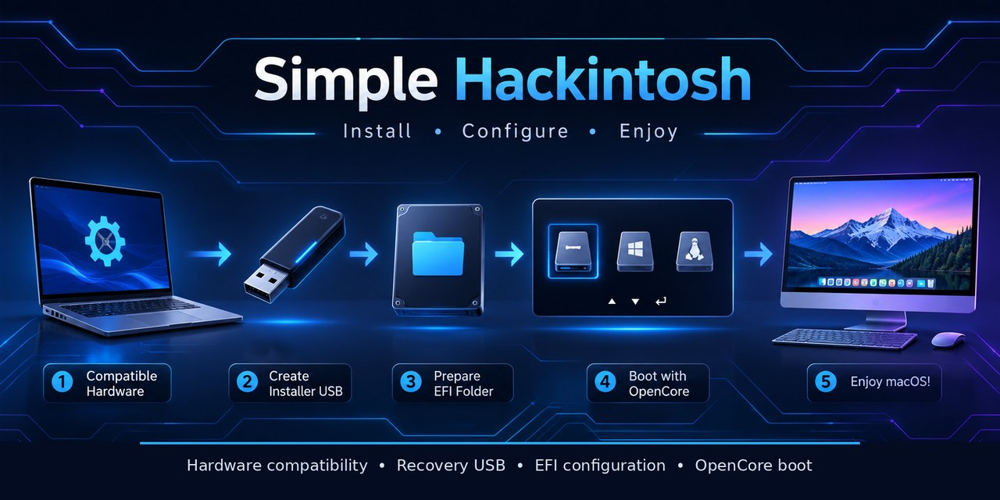

<div align="center">

# Simple Hackintosh

### A practical, step-by-step OpenCore learning guide



**Identify hardware · Check compatibility · Prepare the installer · Build EFI · Install · Troubleshoot**

</div>

---

> **Read first:** This repository is an educational documentation project, not a one-click installer and not a guarantee that macOS will work on a particular PC. Hardware support varies by exact component and macOS release. Do not copy another computer's EFI folder blindly.

## What this guide covers

Simple Hackintosh explains the workflow from the first hardware inventory to a tested OpenCore setup. It emphasizes understanding each file and configuration entry rather than downloading a ready-made EFI and hoping it works.

This project does **not** distribute macOS installers, Apple firmware, third-party Kext binaries, device-specific EFI folders, serial numbers, or other private identifiers. Obtain software only from its official project source and follow its license terms.

## Visual walkthrough

The screenshots below are linked directly from the [Dortania OpenCore Install Guide](https://dortania.github.io/OpenCore-Install-Guide/). They are real instructional screenshots, but some show older OpenCore-era examples. Use them to recognize the screens and folder layout only; always follow the current instructions for your OpenCore release and hardware. Never copy the sample Kexts, ACPI files, or configuration values to another computer.

### 1. Format the USB with Rufus


Source: [Dortania — Making the installer in Windows](https://dortania.github.io/OpenCore-Install-Guide/installer-guide/windows-install.html). Formatting erases the selected device. Verify its name and capacity before starting.

### 2. Download macOS Recovery


Source: [Dortania — Recovery download](https://dortania.github.io/OpenCore-Install-Guide/installer-guide/mac-install-recovery.html). The screenshot illustrates the utility output; use the command for your target macOS version from the current documentation.

### 3. Check the downloaded Recovery files


Source: [Dortania — Windows installer](https://dortania.github.io/OpenCore-Install-Guide/installer-guide/windows-install.html). Keep the matching image and chunklist together. Depending on the selected recovery method, the files may instead be named RecoveryImage.

### 4. Check the USB root layout


Source: [Dortania — Windows installer](https://dortania.github.io/OpenCore-Install-Guide/installer-guide/windows-install.html). The EFI folder and recovery directory are both placed at the USB root.

### 5. Understand the EFI directory


Source: [Dortania — config.plist setup](https://dortania.github.io/OpenCore-Install-Guide/config.plist/). This is a layout example, not a ready-to-use EFI. Your ACPI files, Kexts, drivers, and settings must match your own hardware.

### 6. Locate Sample.plist


Source: [Dortania — config.plist setup](https://dortania.github.io/OpenCore-Install-Guide/config.plist/). Use the Sample.plist from the same OpenCorePkg release as the other EFI files.

### 7. Place config.plist in EFI/OC


Source: [Dortania — config.plist setup](https://dortania.github.io/OpenCore-Install-Guide/config.plist/). The file belongs at EFI/OC/config.plist.

### 8. ProperTree Clean Snapshot

Before:


After:


Source: [Dortania — config.plist setup](https://dortania.github.io/OpenCore-Install-Guide/config.plist/). Clean Snapshot synchronizes file entries; it does not decide which hardware files or settings are correct.

> **Image attribution:** These screenshots are hosted by Dortania and are linked here for educational context. Consult the original pages for current instructions and applicable licensing information.

## Follow the guide in order

| Step | What you will do | Guide |
| — | View screenshots of key stages | [Visual walkthrough](docs/16-visual-walkthrough.md) |
|---|---|---|
| 1 | Record exact hardware models and PCI IDs | [Hardware inventory](docs/01-hardware-inventory.md) |
| 2 | Decide whether the hardware and macOS version are suitable | [Compatibility check](docs/02-compatibility.md) |
| 3 | Prepare a macOS Recovery USB in Windows | [USB installer — Windows](docs/03-usb-installer-windows.md) |
| 4 | Understand and assemble the EFI directory | [EFI structure](docs/04-efi-structure.md) |
| 5 | Select ACPI files, Kexts, and UEFI drivers | [ACPI, Kexts, and drivers](docs/05-acpi-kexts-drivers.md) |
| 6 | Build and review `config.plist` | [Configuration](docs/06-config-plist.md) |
| 7 | Validate the EFI and collect useful logs | [Validation and debugging](docs/07-validation-debugging.md) |
| 8 | Boot Recovery and install macOS safely | [Installation](docs/08-installation.md) |
| 9 | Test hardware and complete post-install tasks | [Post-installation](docs/09-post-installation.md) |
| 10 | Map USB ports and understand Tahoe-specific notes | [USB mapping](docs/10-usb-mapping.md) · [Tahoe 26](docs/11-macos-tahoe-26.md) |
| 11 | Plan dual boot, backups, and future updates | [Dual boot](docs/12-dual-boot.md) · [Maintenance](docs/13-maintenance.md) |
| 12 | Diagnose common boot and hardware issues | [Troubleshooting](docs/14-troubleshooting.md) |

## Start here

1. Read [Important safety and legal notes](docs/00-read-first.md).
2. Complete the [hardware report template](templates/hardware-report.md).
3. Check the exact CPU, GPU, Wi-Fi, audio, and storage devices against the official guides.
4. Choose a macOS version only after checking support for the **whole computer**, not just the CPU.
5. Keep a separate, verified backup of the original EFI and important personal files.

## Important official references

- [Dortania OpenCore Install Guide](https://dortania.github.io/OpenCore-Install-Guide/)
- [OpenCorePkg — official releases and source](https://github.com/acidanthera/OpenCorePkg)
- [OpenCore reference documentation](https://dortania.github.io/docs/)
- [OpenCore Post-Install Guide](https://dortania.github.io/OpenCore-Post-Install/)
- [Getting Started with ACPI](https://dortania.github.io/Getting-Started-With-ACPI/)
- [Dortania macOS 26 / Tahoe notes](https://dortania.github.io/OpenCore-Install-Guide/extras/tahoe.html)

The Dortania guide and the OpenCore reference manual may not always display the same release number. Always use the documentation and `ocvalidate` that match the exact OpenCore package you downloaded. Never mix EFI binaries, drivers, tools, and configuration examples from unrelated releases.

## Repository structure

```text
Simple-Hackintosh/
├── README.md
├── LICENSE
├── CONTRIBUTING.md
├── SUPPORT.md
├── CHANGELOG.md
├── docs/
│   ├── 00-read-first.md
│   ├── 01-hardware-inventory.md
│   ├── 02-compatibility.md
│   ├── 03-usb-installer-windows.md
│   ├── 04-efi-structure.md
│   ├── 05-acpi-kexts-drivers.md
│   ├── 06-config-plist.md
│   ├── 07-validation-debugging.md
│   ├── 08-installation.md
│   ├── 09-post-installation.md
│   ├── 10-usb-mapping.md
│   ├── 11-macos-tahoe-26.md
│   ├── 12-dual-boot.md
│   ├── 13-maintenance.md
│   ├── 14-troubleshooting.md
│   └── 15-glossary.md
├── images/
│   └── installation-flow.jpg
└── templates/
    ├── hardware-report.md
    └── problem-report.md
```

## Publishing to GitHub

See [PUBLISHING.md](PUBLISHING.md) for uploading the files and setting the repository Social Preview image.

## Project status

Documentation is being expanded and should be treated as a learning reference. Before following any command, confirm that it still matches the current OpenCore release, macOS version, and hardware platform.

## License

The original documentation in this repository is released under the MIT License. Third-party software, Apple software, trademarks, and external documentation remain subject to their own licenses and terms. See [LICENSE](LICENSE).
