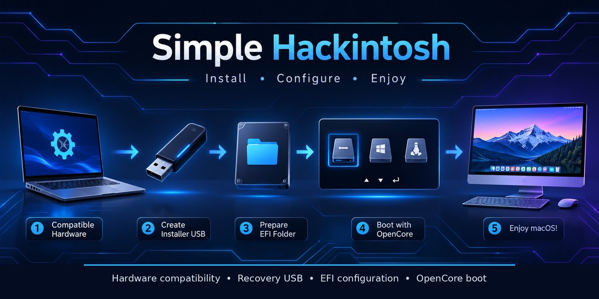

# Simple Hackintosh

### A practical, illustrated guide to understanding OpenCore

**Identify hardware → Check compatibility → Prepare Recovery → Build EFI → Install → Validate**

[**Open the live field guide ↗**](https://kiwewe09-aa.github.io/Simple-Hackintosh/)

---

> [!IMPORTANT]
> This is an educational guide, not a one-click installer and not a guarantee that macOS will work on a particular computer. Compatibility depends on the exact CPU, graphics processor, firmware, wireless card, storage controller, and macOS release. Never copy another computer's EFI folder without understanding and adapting every component.

## Python command-line utility

The repository includes a standalone Python CLI for Windows CMD and PowerShell. It runs locally; it is not a website wrapper and requires no third-party Python packages.

- [Python CLI source, CMD launcher, commands, and tests](app/python/README.md)
- [Python CLI test workflow](.github/workflows/python-cli.yml)

From the `app/python` folder, run `run.bat --help` or `py -3 simple_hackintosh.py --help`. The program can inventory Windows hardware, inspect an EFI folder or ZIP, and perform a basic config.plist structure check. It does not upload files or modify disks, EFI files, or firmware. Its checks do not replace official OpenCore validation or hardware-specific compatibility research.

## What this project is

Simple Hackintosh teaches the concepts and workflow behind installing and maintaining macOS on non-Apple x86-64 hardware with OpenCore. The goal is to explain *why* each part of an EFI exists, how to check whether hardware is supported, and how to validate a configuration before relying on it.

This repository does **not** distribute macOS installers, Apple firmware, third-party binary packages, prebuilt device-specific EFI folders, or personal SMBIOS identifiers. Obtain tools and Kexts from their official project sources and respect their licenses.

## The learning path

| Stage | Goal | Chapter |
|---|---|---|
| 0 | Understand risks, requirements, and legal notes | [Read first](docs/00-read-first.md) |
| 1 | Collect exact hardware names and PCI IDs | [Hardware inventory](docs/01-hardware-inventory.md) |
| 2 | Check every important component for compatibility | [Compatibility](docs/02-compatibility.md) |
| 3 | Prepare a macOS Recovery USB from Windows | [Windows USB installer](docs/03-usb-installer-windows.md) |
| 4 | Understand the EFI folder and its required structure | [EFI structure](docs/04-efi-structure.md) |
| 5 | Select ACPI tables, Kexts, and UEFI drivers | [ACPI, Kexts, and drivers](docs/05-acpi-kexts-drivers.md) |
| 6 | Configure OpenCore for the actual hardware | [config.plist](docs/06-config-plist.md) |
| 7 | Validate the EFI and collect useful logs | [Validation and debugging](docs/07-validation-debugging.md) |
| 8 | Boot Recovery and install macOS carefully | [Installation](docs/08-installation.md) |
| 9 | Test hardware after the first boot | [Post-installation](docs/09-post-installation.md) |
| 10 | Map USB ports correctly | [USB mapping](docs/10-usb-mapping.md) |
| 11 | Review macOS 26-specific caveats | [Tahoe 26](docs/11-macos-tahoe-26.md) |
| 12 | Protect existing systems and boot files | [Dual boot](docs/12-dual-boot.md) |
| 13 | Maintain OpenCore and prepare updates | [Maintenance](docs/13-maintenance.md) |
| 14 | Diagnose common startup and hardware problems | [Troubleshooting](docs/14-troubleshooting.md) |
| 15 | Learn the terminology | [Glossary](docs/15-glossary.md) |
| 16 | See annotated screenshots of key stages | [Visual walkthrough](docs/16-visual-walkthrough.md) |

## Before starting

1. Read [Read first](docs/00-read-first.md), including backup and legal notes.
2. Fill in the [hardware report template](templates/hardware-report.md).
3. Check the exact CPU, GPU, Wi-Fi/Bluetooth, Ethernet, audio codec, and storage controller. A product-family name alone is not enough.
4. Choose a macOS version only after checking the whole computer against current documentation.
5. Keep a verified backup of personal files and any existing boot configuration before changing firmware or disk partitions.

## How OpenCore fits together

OpenCore is a boot loader. It prepares the environment macOS expects by loading selected ACPI tables, drivers, and Kexts, and by applying settings from config.plist. It does not make unsupported hardware magically compatible. Each file must have a reason to exist and must match the computer and the OpenCore version in use.

A typical EFI contains:

- BOOT: the UEFI fallback boot file.
- OC: the OpenCore folder.
- ACPI: selected ACPI tables.
- Drivers: required UEFI drivers.
- Kexts: kernel extensions and their dependencies.
- Resources: optional picker assets.
- Tools: optional boot-time utilities.
- config.plist: the configuration that connects these parts.

See [EFI structure](docs/04-efi-structure.md) before assembling files.

## Visual learning

The [visual walkthrough](docs/16-visual-walkthrough.md) includes reference screenshots for USB preparation, Recovery files, EFI layout, and ProperTree. Those screenshots are illustrative; they are not a ready-made configuration. Always follow the current official documentation.

## Official references

- [Dortania OpenCore Install Guide](https://dortania.github.io/OpenCore-Install-Guide/)
- [OpenCorePkg releases](https://github.com/acidanthera/OpenCorePkg/releases)
- [OpenCorePkg documentation](https://github.com/acidanthera/OpenCorePkg/tree/master/Docs)
- [OpenCore Post-Install Guide](https://dortania.github.io/OpenCore-Post-Install/)
- [Getting Started with ACPI](https://dortania.github.io/Getting-Started-With-ACPI/)
- [Dortania macOS 26 / Tahoe notes](https://dortania.github.io/OpenCore-Install-Guide/extras/tahoe.html)
- [GPU Buyers Guide](https://dortania.github.io/GPU-Buyers-Guide/)
- [Wireless Buyers Guide](https://dortania.github.io/Wireless-Buyers-Guide/)

**Version rule:** Download one OpenCore release and use its matching EFI binaries, Sample.plist, tools, and ocvalidate. The generated Dortania guide may display a different supported-version banner from the newest GitHub release. Do not mix files from different releases; check both the guide and documentation shipped with the exact package.

## Repository layout

- docs/: the numbered learning chapters.
- templates/: blank hardware and troubleshooting report forms.
- social-preview.jpg: repository sharing artwork.
- social-preview-640.jpg: smaller preview image.
- SOURCES.md: primary technical references.
- CONTRIBUTING.md: documentation contribution rules.
- SUPPORT.md: how to prepare a useful, redacted support report.

## Safety, privacy, and licensing

Disk formatting and partition changes can erase data. Firmware changes can prevent a computer from starting until settings are restored. Back up first, verify the target disk by model and capacity, and do not change settings you do not understand.

Do not publish serial numbers, MLB, SystemUUID, ROM, MAC addresses, passwords, account details, or an unredacted EFI. Do not upload macOS installers, Apple firmware, or third-party binaries unless redistribution is explicitly permitted.

Apple's software license and local law may restrict installing or running macOS on non-Apple hardware. Read the applicable terms yourself; this project is not legal advice.

The original documentation is released under the MIT License. External software, screenshots, trademarks, and third-party documentation remain subject to their own licenses and terms. See [LICENSE](LICENSE).

## Project status

This is a learning reference. Hardware-specific instructions should state the exact scope and should be checked against current upstream documentation before use.
