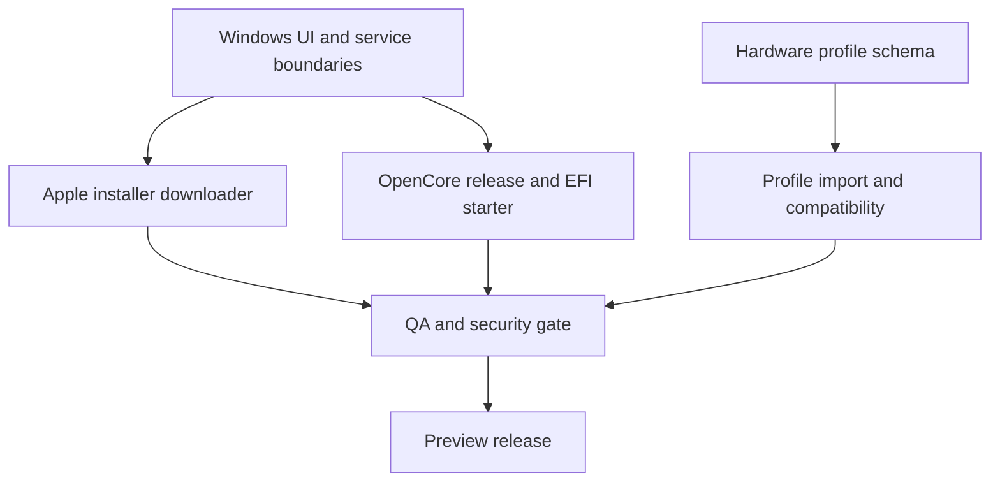

# Windows Desktop Studio — Factory Work Packages

**Target:** Simple Hackintosh Windows desktop v0.2 → v0.3  
**Current delivery branch:** `chatgpt/windows-desktop-app-v2`  
**Coordination rule:** one owner per workstream; shared contracts are reviewed before integration.

## Architecture decision

Keep the existing native Windows Forms application on .NET 10. Do not introduce a second CMD front end, Electron runtime, or a second UI framework. Long-running network and file operations belong in cancellable async services; UI code only coordinates state and presents progress.

## Workstream A — Windows application architecture

**Deliverables**
- Keep navigation and page construction in `MainForm`.
- Move network and archive logic into testable service classes under `app/windows`.
- Standardize busy, progress, cancellation, error and success states.
- Keep downloads in the folder selected by the user; never silently choose a system drive.

**Acceptance**
- UI remains responsive during downloads.
- Cancellation removes partial output.
- Existing tools (EFI Checker, Config Validator, Hardware Inspector) remain available.

## Workstream B — Apple installer acquisition

**Implemented in v0.2 preview**
- Read Apple's public software-update catalog.
- Select only products marked as full InstallAssistant installers.
- List versions in the GUI.
- Stream the Apple-hosted `InstallAssistant.pkg` directly to a selected folder/drive.
- Validate Apple HTTPS hosts after redirects, check catalog size where available, prevent overwrite and clean partial files.

**Next checks**
- Verify the live catalog format and currently returned product records against Apple's servers.
- Add fixture-driven parser tests for catalog variations and malformed records.
- Test cancellation, disk-full, network interruption, redirect rejection and existing-file behavior.

## Workstream C — OpenCore and EFI engineering

**Next deliverables**
1. Discover official OpenCorePkg releases from the Acidanthera GitHub repository.
2. Verify release archive SHA-256 against GitHub's published asset digest before extraction.
3. Build a non-destructive x64 OpenCore starter directory from the official release.
4. Place the matching `Docs/Sample.plist` at `EFI/OC/config.plist`.
5. Add a clear starter-only warning and matching-version `ocvalidate` guidance.
6. Later, import the shared hardware profile and generate a hardware-specific configuration proposal.

**Acceptance**
- No existing EFI folder is overwritten.
- Archive path traversal is rejected.
- Digest mismatch aborts before extraction.
- A generic sample is never described as boot-ready.
- No internal disk, EFI System Partition, partition table, or firmware setting is changed.

## Workstream D — Hardware profile and compatibility

**Deliverables**
- Export a privacy-conscious JSON profile matching `schemas/hardware-profile-v1.schema.json`.
- Import the same profile in macOS Studio.
- Include CPU, GPU/PCI IDs, network, audio, storage and firmware facts where Windows exposes them.
- Exclude serial numbers, UUIDs, SMBIOS identity values and MAC addresses.

**Acceptance**
- JSON validates against schema v1.
- Missing fields are represented as unknown/omitted rather than guessed.
- Reports distinguish detected facts from compatibility inferences.

## Workstream E — Security review

**Required review points**
- HTTPS and redirect host allowlists for Apple downloads.
- Official GitHub release provenance and SHA-256 digest verification.
- ZIP traversal, symlink and decompression-bomb defenses.
- File overwrite and partial-file behavior.
- No secrets, serials or MAC addresses in logs or exported profiles.
- No destructive disk operations without explicit disk identity and a second confirmation.

## Workstream F — QA and release engineering

**Checks**
- .NET 10 restore and Windows x64 publish.
- Unit tests for catalog parsing, URL allowlists, size validation, archive filtering and safe output paths.
- CI artifact inspection.
- Manual smoke test on Windows 10/11 for scaling, keyboard navigation, cancellation and external-drive destination.

**Release gate**
- CI green.
- Security review complete.
- No unsupported claim that a starter EFI is ready to boot.
- Publish a preview artifact first; do not tag a stable release until the full workflow is tested on real hardware.

## Dependencies

## Current status

- [x] Native Windows Forms shell and three local diagnostic pages.
- [x] Apple full-installer catalog and direct-to-selected-drive download preview.
- [ ] Live Apple catalog smoke test on Windows.
- [ ] Automated Windows unit-test project.
- [ ] Official OpenCore release downloader and starter EFI builder.
- [ ] Hardware profile JSON export/import.
- [ ] Final QA and signed/notarized macOS counterpart coordination.
