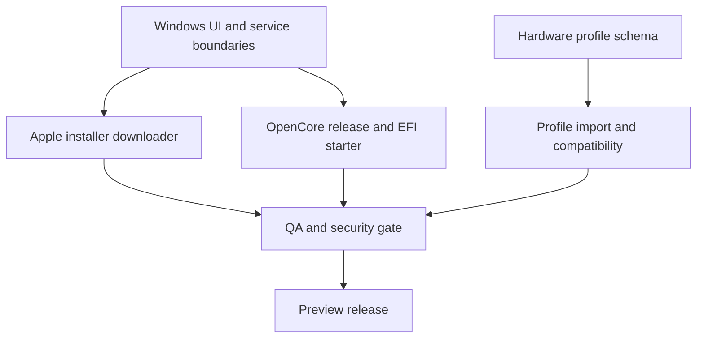

# Windows Desktop Studio — Factory Work Packages

**Target:** Simple Hackintosh Windows desktop v0.4 preview  
**Current delivery branch:** `chatgpt/windows-desktop-app-v2`  
**Coordination rule:** one owner per workstream; shared contracts are reviewed before integration.

## Architecture decision

Keep the existing native Windows Forms application on .NET 10. Do not introduce a second CMD front end, Electron runtime, or a second UI framework. Long-running network and file operations belong in cancellable async services; UI code only coordinates state and presents progress.

## Workstream A — Windows application architecture

**Deliverables**
- Keep navigation and page construction in `MainForm`.
- Move network and archive logic into testable service classes under `app/windows`.
- Standardize busy, progress, cancellation, error and success states.
- Keep downloads in the folder selected by the user; never silently choose a system drive.

**Acceptance**
- UI remains responsive during downloads.
- Cancellation removes partial output.
- Existing tools (EFI Checker, Config Validator, Hardware Inspector) remain available.

## Workstream B — Apple installer acquisition

**Implemented in v0.2 preview**
- Read Apple's public software-update catalog.
- Select only products marked as full InstallAssistant installers.
- List versions in the GUI.
- Stream the Apple-hosted `InstallAssistant.pkg` directly to a selected folder/drive.
- Validate Apple HTTPS hosts after redirects, check catalog size where available, prevent overwrite and clean partial files.

**Next checks**
- Verify the live catalog format and currently returned product records against Apple's servers.
- Add fixture-driven parser tests for catalog variations and malformed records.
- Test cancellation, disk-full, network interruption, redirect rejection and existing-file behavior.

## Workstream C — OpenCore and EFI engineering

**Implemented in v0.3 preview**
1. Discover the latest stable OpenCorePkg release from the official Acidanthera GitHub API.
2. Require GitHub's published SHA-256 digest and verify the downloaded RELEASE ZIP before extraction.
3. Build a non-destructive x64 starter directory from the official release.
4. Place the matching `Docs/Sample.plist` at `EFI/OC/config.plist`.
5. Reject ZIP traversal, links, duplicate archive paths, excessive entry counts and oversized extraction.
6. Label the result as a starter and provide version-matched `ocvalidate` guidance.

**Implemented in v0.4 preview**
- Download the latest official Acidanthera release archive and verify its GitHub SHA-256 digest before extracting `ocvalidate.exe`.
- Use only an executable found at the expected path inside the verified release archive; stop if no official Windows executable is present.
- Verify the executable's embedded OpenCore version banner before running it against the user's XML `config.plist`.
- Capture structured success/failure output, impose a process timeout, and support cancellation.

**Partially implemented in v0.4 preview**
- Add a read-only guided EFI preparation checklist generated from an imported or locally detected Hardware Profile v1.
- Separate reported hardware facts from information that still requires manual confirmation; do not infer compatibility or auto-enable quirks.

**Implemented in v0.4 preview**
- Add an official Kext Library for selected Acidanthera projects.
- Require the upstream GitHub SHA-256 digest before downloading; verify archive size and digest before extracting.
- Extract only Kext bundles from verified archives into a new, non-overwriting staging folder. Never edit an existing EFI or `config.plist`.
- Refuse to download release assets that do not publish a verifiable SHA-256 digest; leave the official release page available for manual review.

**Partially implemented in v0.4 preview**
- Add a non-destructive scalar editor for existing String, Integer, Real, and Boolean values in XML config.plist files.
- Support property-path filtering and save-as-new-file; never overwrite the source file.
- Keep arrays, dictionaries, binary Data and Date values read-only until their versioned schema rules are implemented.

**Implemented in v0.5 preview**
- Import an exact official OpenCore RELEASE ZIP for offline validation.
- Require the SHA-256 digest copied from the corresponding Acidanthera GitHub release asset; compare it before parsing or extracting the validator.
- Keep the selected archive open read-only while hashing and extracting, preventing file replacement between verification and use.
- Validate expected x64 EFI and Sample.plist entries, the exact Windows validator path, duplicate paths, links, traversal, archive entry count and expanded size.
- Cache the extracted validator with a SHA-256 sidecar and add the imported release to the Config Validator version selector.

**Remaining**
- Expand the scalar Config Editor into a complete schema-guided editor using the exact schema shipped with the selected OpenCore version.
- Add per-component macOS compatibility metadata and OpenCore dependency guidance based on upstream documentation.

**Acceptance**
- No existing EFI folder is overwritten.
- Archive path traversal is rejected.
- Digest mismatch aborts before extraction.
- A generic sample is never described as boot-ready.
- No internal disk, EFI System Partition, partition table, or firmware setting is changed.

## Workstream D — Hardware profile and compatibility

**Implemented in v0.3 preview**
- Export a privacy-conscious JSON profile matching the shared schema-v1 structure.
- Import and validate schema-v1 profiles in the Windows Hardware Inspector.
- Include CPU, GPU/PCI IDs, network, audio, storage and firmware facts where Windows exposes them.
- Exclude serial numbers, UUIDs, SMBIOS identity values and MAC addresses.

**Acceptance**
- JSON validates against schema v1.
- Missing fields are represented as unknown/omitted rather than guessed.
- Reports distinguish detected facts from compatibility inferences.

## Workstream E — Security review

**Required review points**
- HTTPS and redirect host allowlists for Apple downloads.
- Official GitHub release provenance and SHA-256 digest verification.
- ZIP traversal, symlink and decompression-bomb defenses.
- File overwrite and partial-file behavior.
- No secrets, serials or MAC addresses in logs or exported profiles.
- No destructive disk operations without explicit disk identity and a second confirmation.

## Workstream F — QA and release engineering

**Checks**
- .NET 10 restore and Windows x64 publish.
- Unit tests for catalog parsing, URL allowlists, size validation, archive filtering and safe output paths.
- CI artifact inspection.
- Manual smoke test on Windows 10/11 for scaling, keyboard navigation, cancellation and external-drive destination.
- Verify official Kext downloads against real upstream release assets and inspect the extracted Kext bundle contents on Windows.

**Release gate**
- CI green.
- Security review complete.
- No unsupported claim that a starter EFI is ready to boot.
- Publish a preview artifact first; do not tag a stable release until the full workflow is tested on real hardware.

## Dependencies

## Current status

- [x] Native Windows Forms shell and three local diagnostic pages.
- [x] Apple full-installer catalog and direct-to-selected-drive download preview.
- [ ] Live Apple catalog smoke test on Windows.
- [x] Apple package downloads have no fixed three-minute HttpClient timeout and follow only manually validated HTTPS Apple-domain redirects.
- [x] Automated Windows unit-test project (profile-schema and archive-path safety tests).
- [x] Official OpenCore release downloader and starter EFI builder.
- [x] Official `ocvalidate` download, version check, and config validation (Windows executable is used only when included by the official release archive).
- [x] Select among the latest 20 stable official OpenCore releases for version-matched config validation.
- [x] Official Kext release download and digest verification for SHA-256-published Acidanthera packages.
- [x] Hardware profile JSON export/import (Windows runtime smoke test pending).
- [x] Read-only guided EFI preparation checklist generated from schema-v1 hardware profiles.
- [x] Official Kext Library with digest-required download and safe Kext-only extraction.
- [x] Non-destructive scalar Config Editor with save-as-new-file behavior.
- [x] Offline OpenCore release import UI, digest verification and validator cache tests.
- [ ] Live Apple catalog smoke test on Windows.
- [ ] Windows runtime smoke tests for profile, Kext and EFI flows.
- [ ] Final QA and signed/notarized macOS counterpart coordination.
